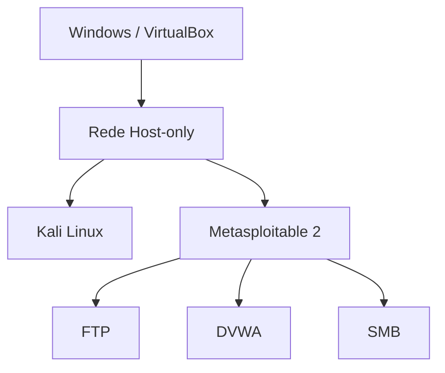

# Segurança de autenticação com Kali Linux e Medusa

Projeto desenvolvido para o desafio de cibersegurança da DIO, com foco no estudo de ataques de força bruta e na prevenção de acessos indevidos.

## Objetivo

Entender como senhas fracas e a ausência de controles de autenticação podem comprometer serviços de rede e aplicações web. O trabalho reúne a preparação inicial do laboratório e um estudo demonstrativo dos cenários propostos.

## Ambiente

Para o laboratório, foram escolhidos o VirtualBox, o Kali Linux e o Metasploitable 2. Durante a preparação, identifiquei um problema na importação do disco VMDK: ele estava sendo adicionado como DVD. A correção foi vinculá-lo como disco rígido virtual. Também configurei o adaptador Host-only da máquina vulnerável para evitar exposição direta à rede externa.



A arquitetura representa o ambiente proposto. A comunicação entre as VMs e os serviços ainda não foi validada.

## Ferramentas estudadas

| Ferramenta | Aplicação |
|---|---|
| Kali Linux | Ambiente de auditoria |
| Medusa | Verificação de credenciais em serviços de rede |
| Nmap | Identificação de portas e serviços |
| DVWA | Estudo de vulnerabilidades web |
| Metasploitable 2 | Ambiente intencionalmente vulnerável |

## Cenários de estudo

### FTP

O FTP tradicional não criptografa as credenciais durante a comunicação. Além disso, uma conta com senha previsível pode ficar exposta a tentativas sucessivas de autenticação. O Medusa permite estudar esse comportamento por meio de módulos específicos para diferentes protocolos.

### DVWA

O formulário de autenticação do DVWA permite estudar a diferença entre uma aplicação que aceita tentativas sucessivas e outra que aplica controles como atraso progressivo e limitação de requisições. Uma resposta HTTP bem-sucedida, por si só, não comprova que o login foi aceito.

### SMB

O SMB é utilizado para compartilhamento de arquivos e outros recursos de rede. A enumeração pode revelar informações sobre contas e compartilhamentos, dependendo da configuração do serviço. No password spraying, uma mesma senha candidata é testada em contas diferentes, ao contrário da força bruta concentrada em uma única conta.

## Demonstração

Para complementar o estudo, foi desenvolvido um simulador local em Python, sem comunicação de rede. Ele utiliza contas fictícias e compara o comportamento de autenticação sem proteção e com limitação de tentativas.

```bash
python3 simulacao.py
```

O resultado do simulador está disponível em [resultado.txt](resultado.txt). Ele representa uma execução do modelo didático, não uma execução do Medusa contra as máquinas virtuais.

## Medidas de prevenção

| Risco | Medida recomendada |
|---|---|
| Senhas previsíveis | Senhas longas e únicas |
| Tentativas repetidas | Limitação de tentativas e atraso progressivo |
| Password spraying | Monitoramento de falhas entre diferentes contas |
| FTP sem criptografia | Substituição por SFTP ou FTPS |
| SMB exposto | Segmentação de rede e desativação de SMBv1 |
| Comprometimento de credenciais | MFA, quando suportado |

## Conclusão

O principal aprendizado deste projeto foi entender que a segurança de autenticação não depende apenas da complexidade da senha. Também é necessário controlar a quantidade de tentativas, monitorar eventos suspeitos e restringir a exposição dos serviços. O estudo mostrou, por meio do modelo local, como a limitação de tentativas pode reduzir a eficácia de ataques repetitivos, embora não seja suficiente para impedir todos os cenários de password spraying.

## Referências

- [Kali Linux](https://www.kali.org/)
- [Medusa](https://github.com/jmk-foofus/medusa)
- [Nmap](https://nmap.org/book/)
- [DVWA](https://github.com/digininja/DVWA)
